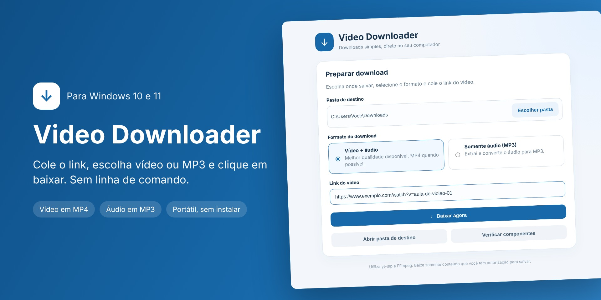
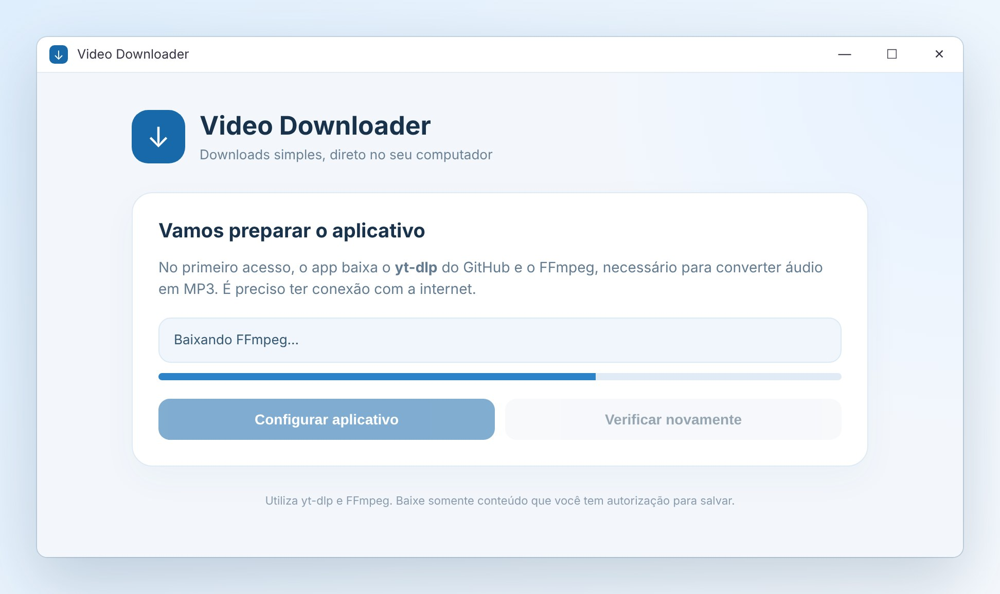
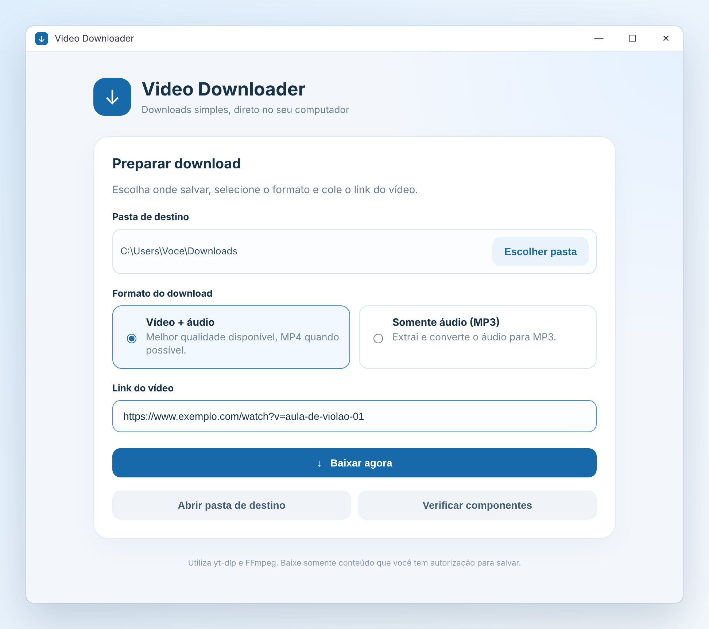
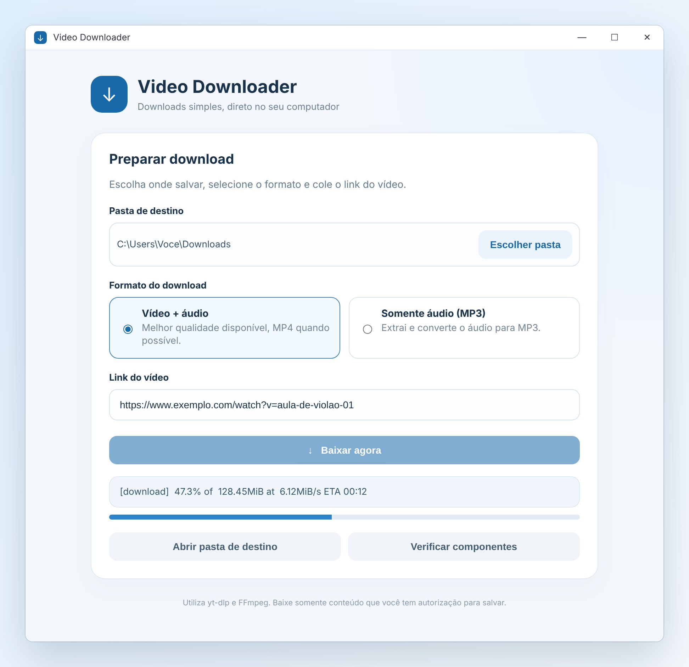
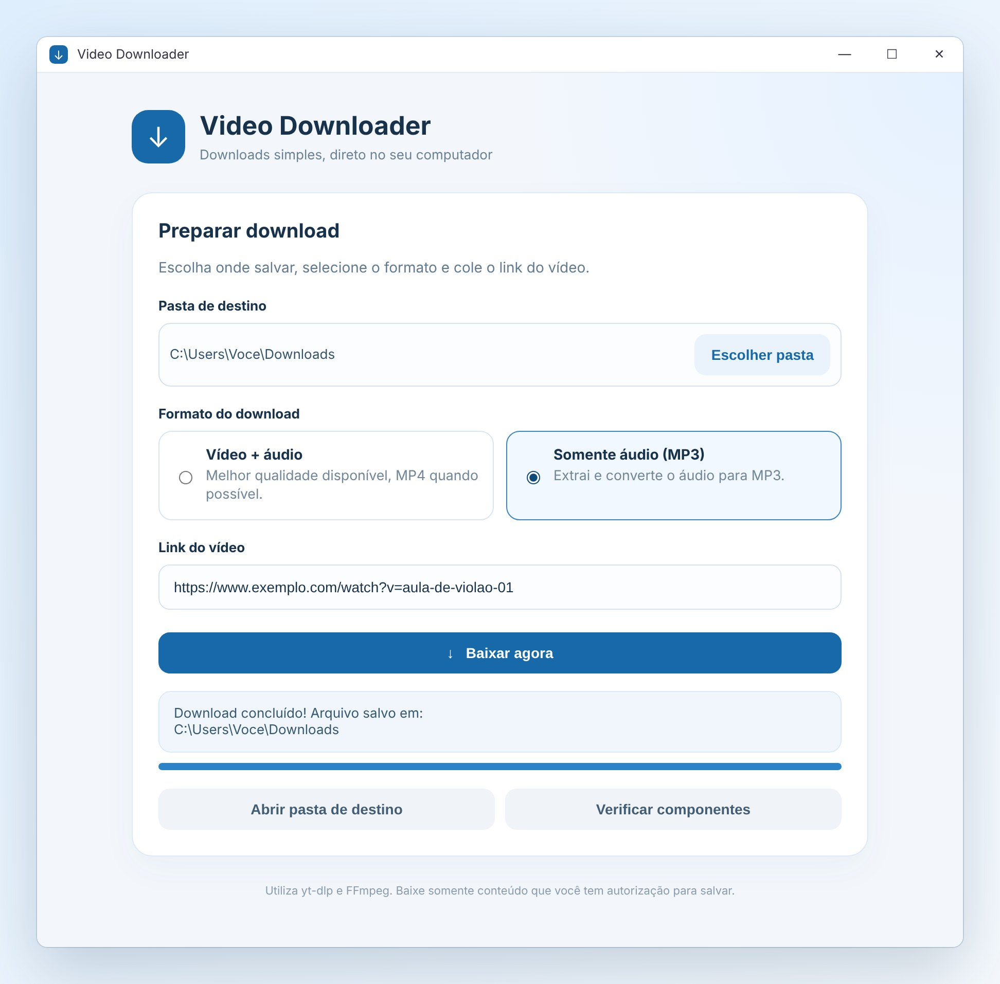

<p align="center">
  
</p>

<h1 align="center">Video Downloader</h1>

<p align="center">
  <b>Baixe vídeos e músicas no Windows em três cliques.</b><br>
  Cole o link, escolha vídeo ou MP3 e clique em <i>Baixar agora</i>. Sem linha de comando, sem instalar nada.
</p>

<p align="center">
  <a href="../../releases/latest"></a>
</p>

<p align="center">
  
  
  
</p>

---

## Por que usar

- **Simples de verdade:** uma janela só, em português. Colou o link, clicou, baixou.
- **Vídeo ou só o áudio:** baixe o vídeo na melhor qualidade disponível (em MP4 sempre que possível) ou extraia só o áudio em **MP3**.
- **Portátil:** é um único arquivo `.exe`. Não precisa instalar, dá para levar num pendrive.
- **Configura sozinho:** no primeiro uso o app baixa e prepara tudo o que precisa (yt-dlp e FFmpeg) com um clique.
- **Você escolhe onde salvar:** a pasta Downloads vem como padrão, e dá para trocar por qualquer outra.
- **Acompanha o progresso:** barra de progresso, tamanho do arquivo, velocidade e tempo restante.
- **Funciona com centenas de sites** suportados pelo [yt-dlp](https://github.com/yt-dlp/yt-dlp).

## Como usar

### 1. Baixe o programa

Clique em **[Baixar para Windows](../../releases/latest)** e baixe o arquivo `.exe` da versão mais recente.
Dê dois cliques para abrir. Se o Windows mostrar o aviso *"O Windows protegeu o computador"*, clique em **Mais informações → Executar assim mesmo** (aparece porque o programa ainda não tem assinatura digital paga).

### 2. Configure no primeiro uso (só uma vez)

Clique em **Configurar aplicativo**. O programa baixa os componentes de download e de conversão para MP3. Leva um ou dois minutos e precisa de internet.

<p align="center"></p>

### 3. Escolha a pasta, o formato e cole o link

- **Pasta de destino:** onde o arquivo vai ser salvo. Clique em *Escolher pasta* para trocar.
- **Formato:** *Vídeo + áudio* para o vídeo completo, ou *Somente áudio (MP3)* para a música.
- **Link do vídeo:** copie o endereço do vídeo no navegador e cole aqui.

<p align="center"></p>

### 4. Clique em **Baixar agora**

Acompanhe o andamento pela barra de progresso.

<p align="center"></p>

### 5. Pronto

Quando terminar, o app avisa onde o arquivo foi salvo. Clique em **Abrir pasta de destino** para ir direto até ele.

<p align="center"></p>

## Dúvidas frequentes

**Preciso instalar alguma coisa?**
Não. Basta abrir o `.exe`. Na primeira vez o próprio app baixa o que precisa.

**Funciona sem internet?**
Não: a internet é necessária para baixar os vídeos e para a configuração inicial.

**Apareceu um erro no download. E agora?**
Confira se o link está completo e começa com `https://`. Se o site mudou recentemente, clique em **Verificar componentes**. Alguns sites ou vídeos (privados, pagos ou protegidos) não permitem download.

**Onde ficam os componentes baixados na configuração?**
Na pasta de dados do aplicativo do seu usuário do Windows, separados dos seus arquivos.

**Funciona no Mac ou no Linux?**
Esta versão é só para Windows 10 e 11 (64 bits).

## Uso responsável

Baixe apenas conteúdo que você tem direito ou autorização para salvar, e respeite os direitos autorais e os termos de uso de cada site. O Video Downloader é uma interface para o [yt-dlp](https://github.com/yt-dlp/yt-dlp) e o [FFmpeg](https://ffmpeg.org/), que são baixados das fontes oficiais na configuração inicial.

---

## Para desenvolvedores

Aplicativo [Electron](https://www.electronjs.org/) com interface em HTML. O processo principal (`src/main.js`) baixa o yt-dlp e o FFmpeg na primeira execução e chama o yt-dlp para cada download. A interface (`src/index.html` + `src/renderer.js`) conversa com ele por uma ponte segura (`src/preload.js`, com `contextIsolation` e `sandbox` ligados).

**Rodar a partir do código** (precisa do [Node.js LTS](https://nodejs.org/)):

```powershell
npm install
npm start
```

**Gerar o `.exe` portátil:** dê dois cliques em `GERAR_EXE_WINDOWS.bat`, ou rode:

```powershell
npm install
npm run dist
```

O executável sai na pasta `dist`.

**Refazer os prints deste README:** `node tools/prints.mjs` (precisa do Playwright; veja o topo do script). Os prints usam a tela real do app com um download simulado.

**Extra:** `yt-dlp_baixar_videos_executar_como_admin.bat` é uma versão mínima em linha de comando, para quem já tem o `yt-dlp.exe`.

```
src/
  main.js       processo principal: configuração, download, pastas
  preload.js    ponte segura entre a tela e o processo principal
  index.html    interface
  renderer.js   comportamento da interface
tools/prints.mjs  gera as imagens de docs/imagens/
```
